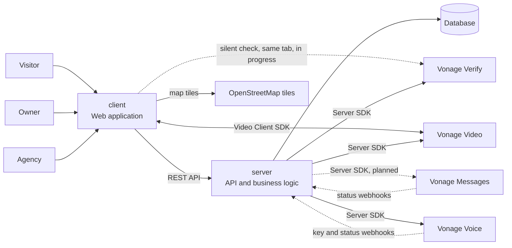
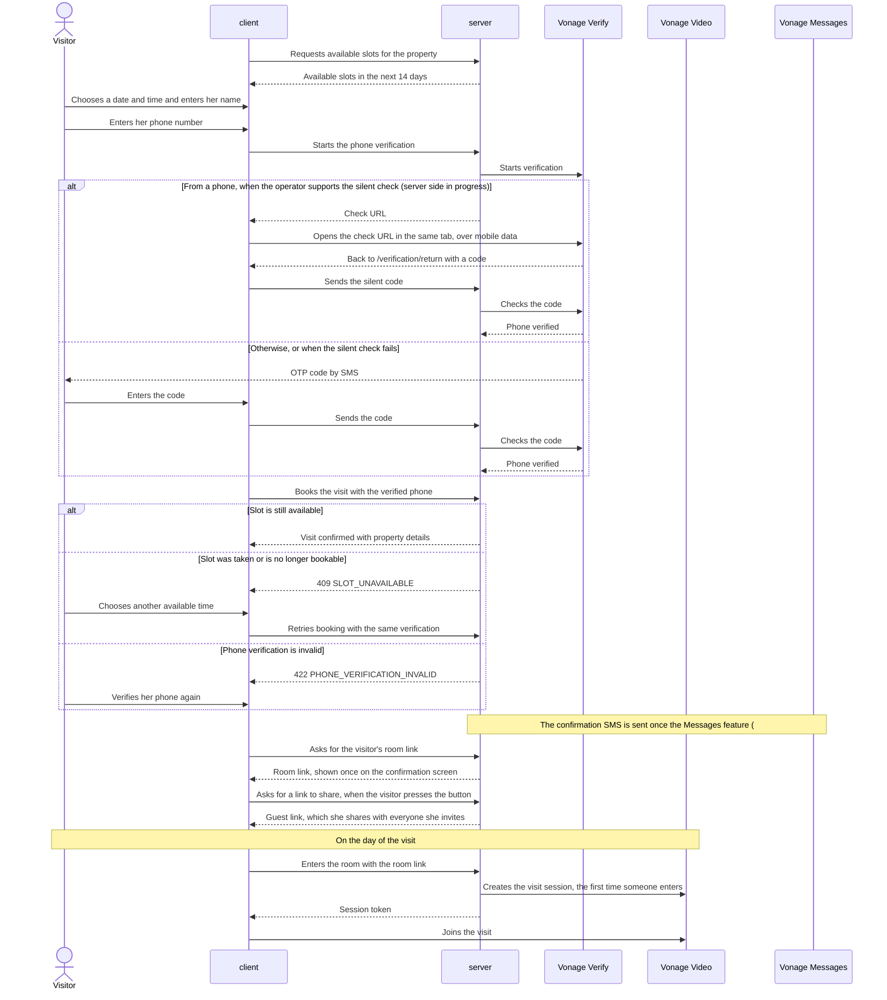

# Architecture

> High-level view, independent of the stack. It will become more concrete as technical decisions are made.

## Overview

Dashed arrows are planned or in progress. Which screens are built is in [User journeys](../user-journeys.md#build-status).

## Main flow: requesting and attending a visit

## Design principles

- **Vonage credentials live only in `server/`.** The client never receives the API secret or the private key; for video it only receives the session token generated by the server
- **All communication with users goes through the server**, so every verification, message and visit is recorded and traceable
- **Vonage webhooks** notify the server of the post-visit call's result, and will notify it of message status once the messages feature is built, so the agency dashboard reflects what actually happened

## Deployment

The client, the server and the database run on Railway as three separate services. The browser only talks to the client's domain: the `client` service proxies `/api` to the server over Railway's private network, as decided in [ADR 0004](../adr/0004-agency-sign-in.md). The server is the only one with Vonage credentials, and its public URL is where Vonage sends the webhooks. The details are in [ADR 0002](../adr/0002-deployment-railway.md).

## Diagrams as code

Diagrams are written in [Mermaid](https://mermaid.js.org/), which GitHub renders natively, and live in this folder. We generate them with the help of AI from the specs and ADRs, and they are reviewed in the pull request like any other change, because an outdated diagram is more confusing than having none at all.
