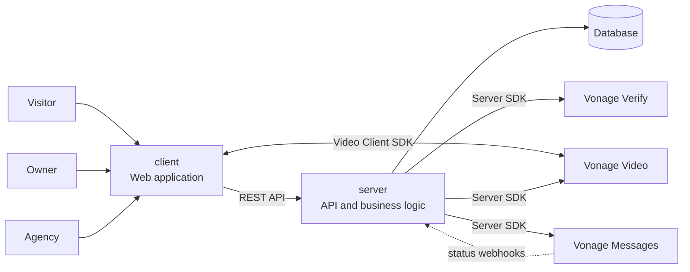
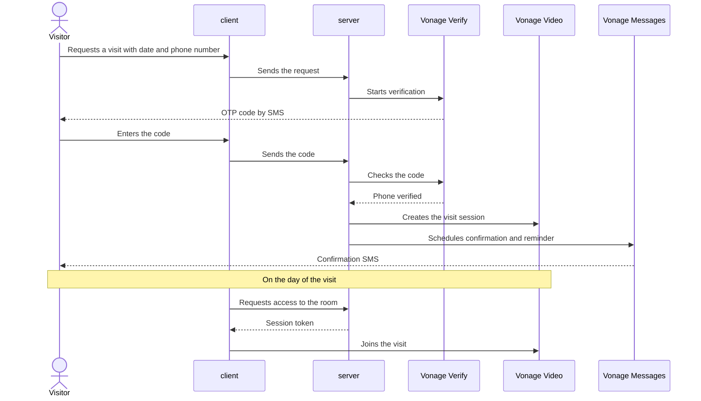

# Architecture

> High-level view, independent of the stack. It will become more concrete as technical decisions are made.

## Overview

## Main flow: requesting and attending a visit

## Design principles

- **Vonage credentials live only in `server/`.** The client never receives the API secret or the private key; for video it only receives the session token generated by the server  
- **All communication with users goes through the server**, so every verification, message and visit is recorded and traceable  
- **Vonage webhooks** notify the server of message status, so the agency dashboard reflects what actually happened

## Diagrams as code

Diagrams are written in [Mermaid](https://mermaid.js.org/), which GitHub renders natively, and live in this folder. We generate them with the help of AI from the specs and ADRs, and they are reviewed in the pull request like any other change, because an outdated diagram is more confusing than having none at all.
