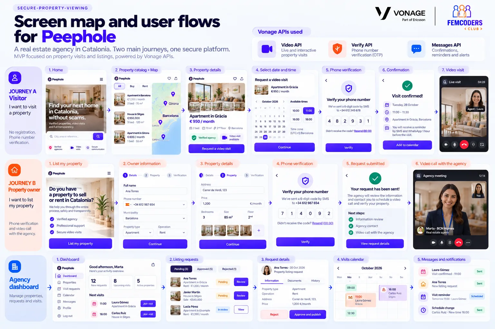

# User journeys

The application has three journeys: one for visitors, one for property owners and the agency dashboard.

The screen map below is an initial mock. Screens may change during development; the specs in `specs/` are the reference for what gets built.

## Journey A · Visitor

Wants to visit a property. No sign-up needed: verifying their phone number is enough.

1. Home  
2. Property catalog + map  
3. Property details  
4. Select date and time  
5. Phone verification  
6. Confirmation  
7. Video visit

After the visit, Peephole calls the visitor with one safety question. It is a phone call, not a screen, and it is described in the [post-visit call spec](../specs/post-visit-call.md).

## Journey B · Property owner

Wants to list their property. Verifies their phone number and validates the request in a video call with the agency.

1. List my property  
2. Owner information  
3. Property details  
4. Phone verification  
5. Request submitted  
6. Video call with the agency

## Agency dashboard

Manages properties, requests and visits.

Every agency screen needs a signed-in agent; a signed-out agent goes to the sign-in page first.

1. Dashboard  
2. Listing requests  
3. Request details  
4. Visits calendar  
5. Messages and notifications

## Build status

What works in `dev` on November 26, 2026. Each spec in `specs/` describes the full feature; this table says how much of it is built.

| Journey | Built | Not built yet |
| :---- | :---- | :---- |
| A · Visitor | Screens 1 to 7: catalog with map, details, calendar, phone verification by SMS code, confirmation and video visit. Silent Authentication, off until `SILENT_AUTH_ENABLED=true`. The post-visit call's server and its alerts on the dashboard, off until `VOICE_CALLS_ENABLED=true`. The confirmation SMS (#87), off until `MESSAGES_SENDING_ENABLED=true` | Silent Authentication with a real number: in Test access, the operator rejects the silent check and the visitor gets the SMS code instead. Real post-visit calls, which wait for the Spanish Vonage number |
| B · Property owner | The server receives listing requests (`POST /api/listing-requests`) | Screens 1 to 5 (#29). Step 6, the video call with the agency, has no spec yet |
| Agency dashboard | Sign-in, screen 1 (the dashboard) and screen 4 (the visits calendar). The server of screens 2 and 3: listing, viewing, approving and rejecting requests (#57) | Screens 2 and 3 (#58). Screen 5 (#119), whose server is built |
