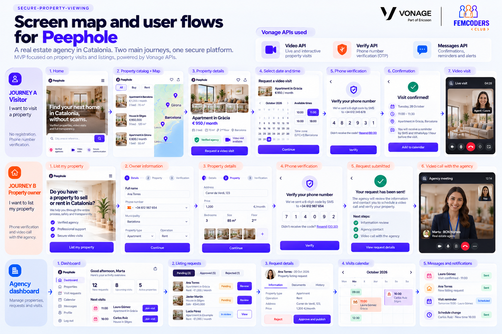

# User journeys

The application has three journeys: one for visitors, one for property owners and the agency dashboard.

The screen map below is an initial mock. Screens may change during development; the specs in `specs/` are the reference for what gets built.

## Journey A · Visitor

Wants to visit a property. No sign-up needed: verifying their phone number is enough.

1. Home  
2. Property catalog + map  
3. Property details  
4. Select date and time  
5. Phone verification  
6. Confirmation  
7. Video visit

## Journey B · Property owner

Wants to list their property. Verifies their phone number and validates the request in a video call with the agency.

1. List my property  
2. Owner information  
3. Property details  
4. Phone verification  
5. Request submitted  
6. Video call with the agency

## Agency dashboard

Manages properties, requests and visits.

1. Dashboard  
2. Listing requests  
3. Request details  
4. Visits calendar  
5. Messages and notifications
