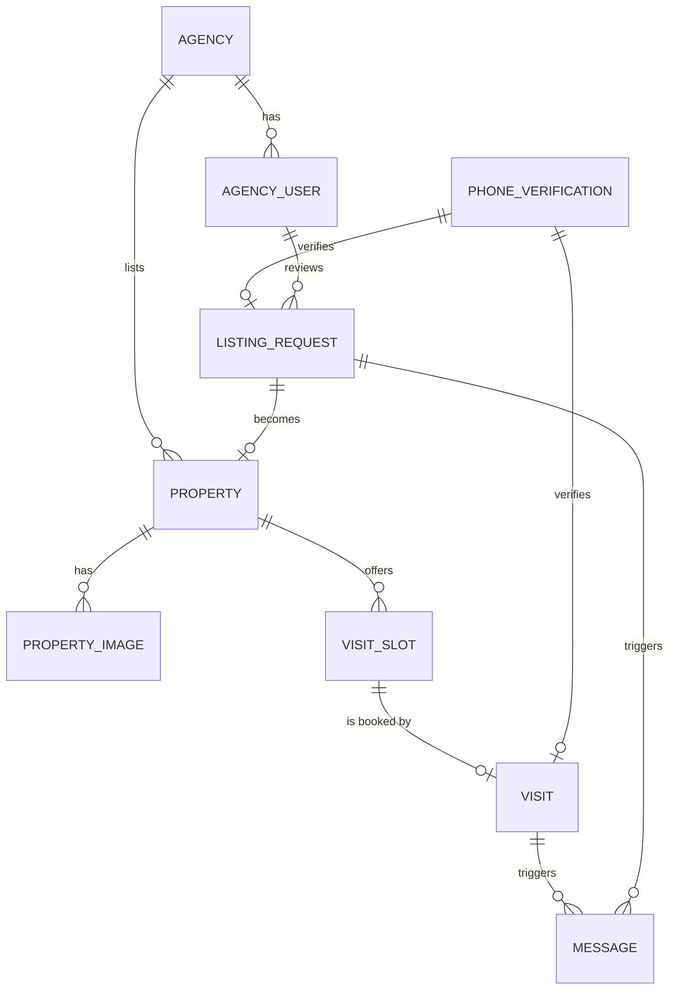

# Data model and API contract

- **Status:** In review
- **Issue:** [#11](https://github.com/femCodersClub-vonage-program/secure-property-viewing/issues/11)
- **Journey:** all three journeys in [`docs/user-journeys.md`](../docs/user-journeys.md)

## Problem

The client and the server are built at the same time by different people. If each side imagines its own data, we only find out when they connect. This spec defines one model and one contract for the whole MVP, taken from the screen map, plus the sample data that the server, the client and the tests share. Feature specs build on it and extend it when they need to.

## User stories

- As a developer working on a screen, I want to know exactly what each endpoint returns, so that I can build with sample data that matches the real API
- As a developer working on the server, I want to know which tables and endpoints the screens need, so that I build what the client will actually use
- As anyone on the team, I want realistic sample data, so that every screen can be tried and demoed without creating data by hand

## Acceptance criteria

- [ ] The entities, their fields and their relationships are the ones listed in this spec, and any change updates this spec in the same pull request
- [ ] Every endpoint follows the conventions below: paths, JSON naming, dates, money and errors
- [ ] Errors are returned as `ProblemDetail` with a stable `code`, as described below
- [ ] The sample data loads with the server, locally and on Railway, and can be reloaded without duplicating rows
- [ ] The sample data is fictional and contains no real person's data
- [ ] The client keeps its sample data for unfinished endpoints in the shape defined here, so switching to the real endpoint needs no change in the components

## Out of scope

- Video sessions and tokens: defined in the video spec in week 2
- Message sending rules: defined in the messages spec in week 2
- Pagination: the MVP has a dozen properties, so lists return everything that matches the filters
- Several agencies: the MVP has one demo agency, although the model keeps `agency_id` so it can grow

## Open questions

- **Agency sign-in in the MVP.** Option A: a real sign-in with email and password for the preloaded users, with a server session. Option B: no sign-in in the MVP, with the dashboard open in the demo and sign-in as an extra. Option A is closer to a real product and gives the security game something to test; option B saves a few days. Proposal: option A, without sign-up or password reset
- **Catalog map.** Proposal: out of the MVP, and back as an extra if there is time
- **Sample data loading.** We would like to agree on the separate `db/seed` location before the first migration is written, since it also means updating the migration rules
- **Address visibility.** Whether the full address is public in the details or shown only after booking a visit. Proposal: municipality and area in the catalog and details, full address in the visit confirmation
- **Publication data.** The listing request does not yet provide the title, description, area and photos required for publication. Agree on their source with the owner listing and agency dashboard specs, then complete the model and approval contract before implementation

## Technical plan

### Conventions

- Every endpoint lives under `/api`. Agency endpoints live under `/api/agency` and require a signed-in agency user
- JSON fields in `camelCase`. Identifiers are numbers
- Dates and times in ISO 8601 with offset, such as `2026-11-10T11:00:00+01:00`. The client shows them in the `Europe/Madrid` time zone
- Prices are whole euros (`priceEuros`). Rent is per month
- Enumerations travel as uppercase strings, such as `RENT` or `PENDING`

### Entities



| Entity | Fields | Notes |
| :---- | :---- | :---- |
| `agency` | id, name, email, phone, verified, created_at | One demo agency in the MVP, verified |
| `agency_user` | id, agency_id, full_name, email, role (`ADMIN`, `AGENT`), created_at | Sign-in fields depend on the [open question](#open-questions) |
| `property` | id, agency_id, listing_request_id (nullable), title, operation (`RENT`, `SALE`), property_type (`APARTMENT`, `HOUSE`, `STUDIO`), price_euros, municipality, area, address, bedrooms, size_m2, floor (nullable), description, video_visit_available, status (`ACTIVE`, `INACTIVE`), created_at | Only `ACTIVE` properties appear in the catalog. `area` is the neighborhood or district, such as Gràcia |
| `property_image` | id, property_id, url, alt_text, position | `alt_text` is required: it describes what the photo shows |
| `visit_slot` | id, property_id, starts_at, ends_at, status (`AVAILABLE`, `BOOKED`) | Slots of 30 minutes in the screen map |
| `visit` | id, property_id, visit_slot_id, phone_verification_id, visitor_name, visitor_phone, status (`CONFIRMED`, `CANCELED`, `COMPLETED`), created_at | A visit exists only once the phone is verified |
| `listing_request` | id, phone_verification_id, owner_full_name, owner_phone, municipality, property_type, operation, address, price_euros, bedrooms, size_m2, floor (nullable), status (`PENDING`, `IN_REVIEW`, `APPROVED`, `REJECTED`), reviewed_by (nullable), rejection_reason (nullable), created_at, in_review_at (nullable), reviewed_at (nullable) | Approving it creates an `ACTIVE` property |
| `phone_verification` | id, purpose (`VISIT`, `LISTING_REQUEST`), phone_hash, vonage_request_id, status (`PENDING`, `VERIFIED`, `FAILED`, `EXPIRED`), check_attempts, created_at, verified_at (nullable) | Detailed in the [phone verification spec](phone-verification.md). The code is never stored, and the phone is kept only as a hash |
| `message` | id, visit_id (nullable), listing_request_id (nullable), type (`CONFIRMATION`, `REMINDER`, `STATUS_UPDATE`), channel (`SMS`), vonage_message_id (nullable), status (`SCHEDULED`, `SUBMITTED`, `DELIVERED`, `FAILED`), scheduled_at, updated_at | Filled in by the messages feature in weeks 3 and 4 |

Phone numbers are personal data: they are stored in E.164 format, used only to contact the person, and never written to logs.

### Endpoints

Public:

| Method and path | Purpose | Spec |
| :---- | :---- | :---- |
| `GET /api/properties?operation=&municipality=` | Catalog, with optional filters | [Property browsing](property-browsing.md) |
| `GET /api/properties/{id}` | Property details | [Property browsing](property-browsing.md) |
| `GET /api/properties/{id}/slots?from=&to=` | Available visit slots | Visit booking (week 2) |
| `POST /api/phone-verifications` | Start a phone verification | [Phone verification](phone-verification.md) |
| `POST /api/phone-verifications/{id}/check` | Check the code | [Phone verification](phone-verification.md) |
| `POST /api/visits` | Book a visit with a verified phone | Visit booking (week 2) |
| `POST /api/listing-requests` | Send a listing request with a verified phone | Owner listing (week 2) |

Agency:

| Method and path | Purpose | Spec |
| :---- | :---- | :---- |
| `GET /api/agency/summary` | Indicators and upcoming visits for the dashboard | [Agency dashboard](agency-dashboard.md) |
| `GET /api/agency/listing-requests?status=` | Listing requests, optionally by status | [Agency dashboard](agency-dashboard.md) |
| `GET /api/agency/listing-requests/{id}` | Request details | [Agency dashboard](agency-dashboard.md) |
| `POST /api/agency/listing-requests/{id}/approve` | Approve and publish | [Agency dashboard](agency-dashboard.md) |
| `POST /api/agency/listing-requests/{id}/reject` | Reject with a reason | [Agency dashboard](agency-dashboard.md) |
| `GET /api/agency/visits?from=&to=` | Visits for the calendar | [Agency dashboard](agency-dashboard.md) |
| `GET /api/agency/messages` | Sent and scheduled messages | [Agency dashboard](agency-dashboard.md) |

Each feature spec defines the exact request and response of its endpoints.

### Errors

Every error is a `ProblemDetail`, as required in `server/AGENTS.md`, with an extra `code` field the client can rely on:

```json
{
  "type": "about:blank",
  "title": "Invalid verification code",
  "status": 422,
  "detail": "The code does not match. Check the SMS and try again.",
  "code": "VERIFICATION_CODE_INVALID"
}
```

| Status | When | `code` |
| :---- | :---- | :---- |
| 400 | The request body or a parameter is not valid | `VALIDATION_FAILED`, with the invalid fields in `errors` |
| 401 | An agency endpoint is called without a signed-in user | `AUTHENTICATION_REQUIRED` |
| 404 | The resource does not exist | `NOT_FOUND` |
| 409 | The action conflicts with the current state, such as booking a slot that is already taken | Defined by each feature |
| 422 | A business rule rejects the action, such as a wrong code | Defined by each feature |
| 429 | Too many attempts | Defined by each feature |
| 500 | Unexpected error, with a generic message and no internal details | `INTERNAL_ERROR` |

The `detail` of a business error is written so the client can show it as it is: it says what went wrong and how to fix it.

### Sample data

- One demo agency with two users, 12 properties in different municipalities of Catalonia (rent and sale, different sizes), with two to four photos each and alternative text
- Visit slots for the next two weeks for every property, some of them already booked
- Listing requests in every status, and visits in the calendar for the dashboard
- Everything fictional: names, addresses and phone numbers are invented and do not belong to anyone

Proposed loading: the schema stays in `db/migration`, as the migration rules require, and the sample data lives in a separate Flyway location, `db/seed`, as a repeatable migration (`R__seed_demo_data.sql`). Repeatable migrations run again when their content changes, so the sample data can evolve without new versions. The seed location is enabled with an environment variable locally and on Railway, and stays off where it is not wanted.

The client mirrors the same data in each feature's sample file while an endpoint is not ready yet.
